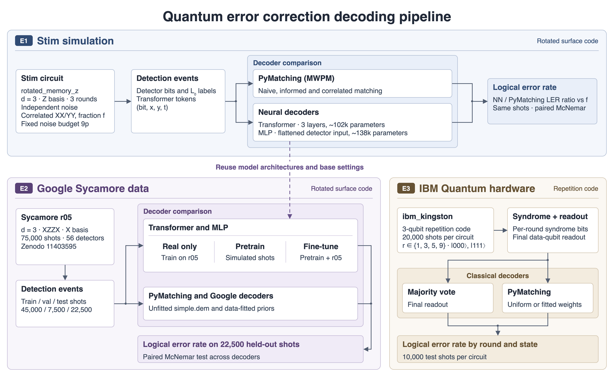
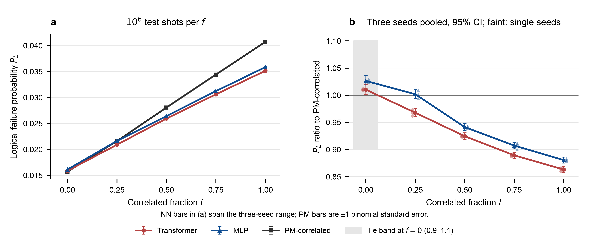
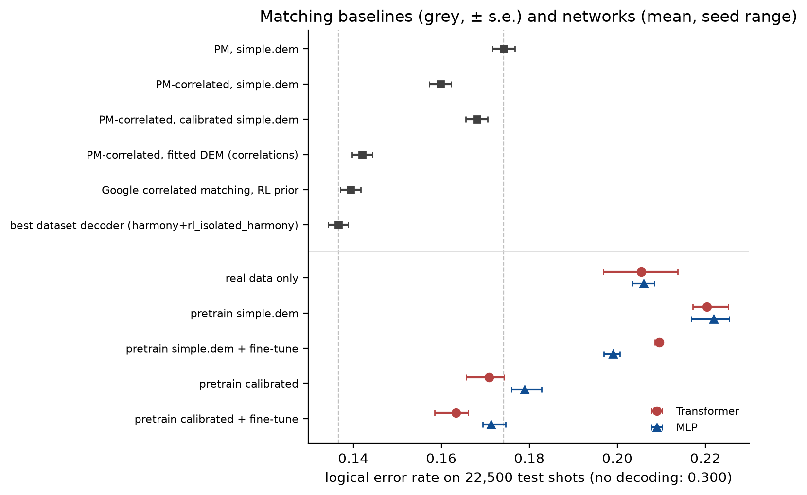

# Small neural-network decoders vs. PyMatching on a distance-3 surface code

Training code, training logs and results behind a course project for 7CCP3000 Quantum Information and Computing (King's College London, 2026/27). The project asks when a small neural-network (NN) decoder is more accurate than minimum-weight perfect matching (PyMatching), and whether its advantage grows as the noise departs from the assumptions of matching.

The report itself is a self-contained Jupyter notebook that is submitted separately. It does not train any model; it reads the results stored here. This repository shows how those results were produced.



## Experiments

| | Data | Decoders | Main script |
|---|---|---|---|
| **E1** (main) | Stim `surface_code:rotated_memory_z`, d = 3, 3 rounds, p = 0.005. A fixed budget of data-qubit errors is split by the correlated fraction f ∈ {0, 0.25, 0.5, 0.75, 1} between independent depolarising errors and XX/YY errors on neighbouring pairs | PM-naive, PM-informed, PM-correlated; transformer, MLP (3 seeds each) | `src/run_e1_pm_fscan.py`, `src/run_e1_tune.py`, `src/run_e1_nn_fscan.py` |
| **E2** | One patch of Google's Sycamore data, `sample_14/d3_at_q4_5/X/r05` of [Zenodo 11403595](https://doi.org/10.5281/zenodo.11403595) (75,000 shots, 56 detectors), split 45,000 / 7,500 / 22,500 | PyMatching with the dataset's DEMs; the dataset's own decoders; transformer and MLP trained in five regimes | `src/run_e2_sycamore.py` |
| **E3** (supplementary) | Three-qubit repetition code on `ibm_kingston`, r ∈ {1, 3, 5, 9}, initial states \|000⟩ and \|111⟩, 20,000 shots each | majority vote, PyMatching (uniform / fitted weights); no NN | `src/ibm_repetition.py`, `src/analyze_e3.py` |





## The training process

- `data/logs/` – the console output of every training run (`e1_tune.log`, `e1_nn_fscan.log`, `e2.log`, `e2_cal.log`), with the training loss and validation logical error rate (LER) at every check.
- `data/results/training_history.csv` – the same curves for all 60 trained models in one table: `experiment, model, f, regime, seed, check, shots_seen` (E1 and E2 pretraining) or `epoch` (E2 training on real shots), `train_loss, val_ler, time_s`.
- `data/results/models_summary.csv` – one row per trained model: parameters, simulated and real training shots, best validation LER, test LER and training time.

The model weights (`.pt`) are not included; the notebook needs only the result tables, which it carries in its own metadata.

Training details: AdamW (weight decay 1e-4), binary cross-entropy, linear warm-up then cosine decay, batch 1024 for simulated shots and 256 for real shots. The weights with the lowest validation LER are kept, and the test shots are never used for any choice. Hyperparameters were tuned once, at E1 f = 0 (`e1_tune.csv`), and then fixed. In E1 every model sees 10⁷ fresh Stim shots. In E2 the regimes are: real shots only; pretraining on `simple.dem` (2×10⁶ shots); pretraining then fine-tuning; pretraining on a calibrated prior (`simple.dem` probabilities × α = 3.31, α fitted on the training shots only; 10⁷ shots); and calibrated pretraining then fine-tuning.

## Repository layout

```
src/                 noise model, PyMatching baselines, networks, training and analysis scripts
data/logs/           training logs
data/results/        result tables (.csv), settings of every run (.settings.json),
                     per-shot error flags used for McNemar tests (e1_preds/, e2_preds/),
                     raw IBM shot data (e3_ibm_raw.npz)
figures/             pipeline, architecture and result figures
```

Every result file has a `.settings.json` with its seeds, sample sizes, hyperparameters and package versions.

## Running the code

Python 3.12 with stim 1.16.0, pymatching 2.4.0, torch 2.15.0, numpy 2.5.3, scipy 1.18.1, pandas and matplotlib. Run the scripts from the repository root, e.g. `python src/run_e1_pm_fscan.py`. The models were trained on an Apple M5 laptop (PyTorch MPS): about 2.5 h for E1 and 1.8 h for E2. MPS is not fully deterministic, so retraining can change the last digits.

E2 needs the Sycamore data, which are not included here. `src/fetch_zenodo_subset.py` downloads the distance-3 part of Zenodo record 11403595, and `src/export_e2_packet.py` extracts the r05 patch that `src/run_e2_sycamore.py` reads. E3 used IBM Quantum hardware. `src/submit_e3_ibm.py` loads a locally saved account, and no credentials are stored in this repository.

## Data and credits

- Sycamore data: Google Quantum AI, data for "Optimization of decoder priors for accurate quantum error correction", Zenodo (2024), [doi:10.5281/zenodo.11403595](https://doi.org/10.5281/zenodo.11403595), CC-BY-4.0. The result files derived from it keep that licence.
- Simulation: [Stim](https://github.com/quantumlib/Stim). Matching: [PyMatching](https://github.com/oscarhiggott/PyMatching).
- Parts of the code were written with AI coding assistants and checked and run by the author; see the report's AI-assistance statement.
