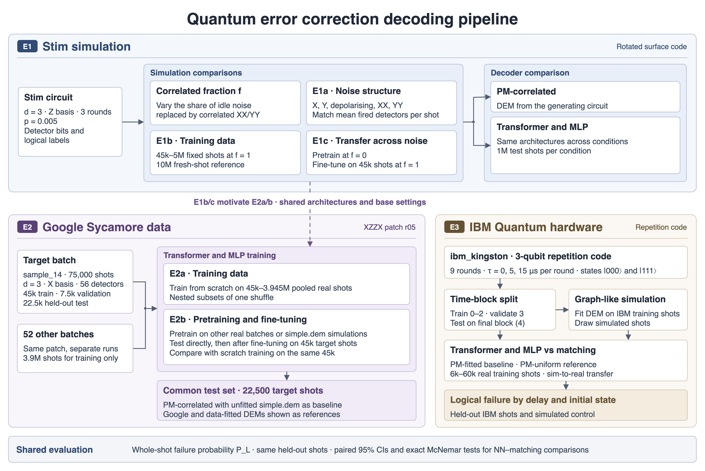

# Small neural-network decoders vs. PyMatching

Training code, training logs and results behind a course project for 7CCP3000 Quantum Information and Computing (King's College London, 2026/27). The project asks when a small neural-network (NN) decoder, a transformer or an MLP, is more accurate than PyMatching, and when it is not.

The report itself is a self-contained Jupyter notebook that is submitted separately. It does not train any model; it reads the result tables stored here. This repository shows how those results were produced.



## Experiments

| | Data | Baseline | Main scripts |
|---|---|---|---|
| **E1** f scan | Stim `surface_code:rotated_memory_z`, d = 3, 3 rounds, p = 0.005; a fraction f of the idle noise on the data qubits acts as XX/YY on neighbouring pairs; 3 seeds | PM-correlated with the true DEM | `run_e1_pm_fscan.py`, `run_e1_tune.py`, `run_e1_nn_fscan.py`, `e1_ratio_ci.py` |
| **E1a** noise structure | Five idle-noise structures (independent depolarising, X, Y; pairs XX, YY) tuned to the same mean number of fired detectors | PM-correlated | `run_e1_structure.py` |
| **E1b** training-set size | f = 1, fixed datasets of 45,000 to 5×10⁶ shots | PM-correlated | `run_e1_datasize.py` |
| **E1c** pretraining | f = 0 model fine-tuned on 45,000 f = 1 shots; post-hoc check with PM given the f = 0 DEM | PM-correlated | `run_e1_finetune.py`, `run_e1_pm_prior.py` |
| **E2** Sycamore | Patch `d3_at_q4_5/X/r05` of [Zenodo 11403595](https://doi.org/10.5281/zenodo.11403595); test run `sample_14`, the 52 other runs as a training pool | PM-correlated with `simple.dem` | `run_e2_v2.py`, `rescore_e2_v2.py` |
| **E3** IBM | 3-qubit repetition code on `ibm_kingston`, 9 rounds, idle delay τ ∈ {0, 5, 15} μs per round, initial states \|000⟩ and \|111⟩, 300,000 shots in five time blocks | PM-fitted (edge probabilities fitted on the training blocks) | `submit_e3_ibm_v2.py`, `retrieve_e3_ibm_v2.py`, `run_e3_v2.py` |

All models use one seed except the E1 f scan. Each `run_*` script has a matching `check_*` script that re-reads the saved predictions and recomputes the tables (`check_e1v2.py`, `check_e2v2.py`, `check_e3v2.py`). `plot_e2v2.py` and `plot_e3v2.py` draw the E2 and E3 figures; `embed_notebook_data.py` packs the result tables into the report notebook.

Some files of an earlier version of the project are kept only because the current scripts read them: the lookup-table predictions in `e1_preds/` (used by `e1_ratio_ci.py`), and the first E2 run (`e2_nn.csv`, `e2_preds/`, `e2_split.npz`, `e2.log`), whose `simple.dem` conditions and train/validation/test split are reused in E2.

## Repository layout

```
src/                 noise models, PyMatching baselines, networks, training, checking and plotting scripts
data/logs/           console output of every training run
data/results/        result tables (.csv) and the settings of every run (.settings.json)
  *_preds/           per-shot error flags used for the paired statistics
  *_models/          training curves of every model (.history.json); the weights (.pt) are not included
  e3_ibm_v2_*        IBM job record and the raw measured bits of E3
data/e2_pool/        list of the Sycamore runs used in E2 (the shots themselves are not included)
figures/             figures of the report
```

Every result file has a `.settings.json` with its seeds, sample sizes, hyperparameters and package versions, written before training.

## Training

AdamW (weight decay 1e-4), binary cross-entropy, batches of 1024 shots, a linear warm-up then cosine decay. Hyperparameters were chosen once, at E1 f = 0 (`e1_tune.csv`), and then fixed. The weights with the lowest validation P_L are kept, and the test shots are used only for the final score. Training from scratch on fixed datasets runs for at most 50 epochs and stops after 10 without improvement; fine-tuning uses a learning rate of 1e-4, at most 30 epochs and stops after 8.

## Running the code

Python 3.12 with stim 1.16.0, pymatching 2.4.0, torch 2.15.0, numpy, scipy, pandas and matplotlib; qiskit and qiskit-ibm-runtime for E3. Run the scripts from the repository root, e.g. `python src/run_e1_pm_fscan.py`. The models were trained on an Apple M5 laptop (PyTorch MPS), which is not fully deterministic, so retraining can change the last digits.

E2 needs the Sycamore data, which are not included here: `src/fetch_zenodo_subset.py` downloads the distance-3 part of Zenodo record 11403595, and `src/export_e2_packet.py` and `src/export_e2_pool.py` extract the r05 patch and the training pool. E3 used IBM Quantum hardware; `src/submit_e3_ibm_v2.py` loads a locally saved account, and no credentials are stored in this repository.

## Data and credits

- Sycamore data: Google Quantum AI, data for "Optimization of decoder priors for accurate quantum error correction", Zenodo (2024), [doi:10.5281/zenodo.11403595](https://doi.org/10.5281/zenodo.11403595), CC-BY-4.0. The result files derived from it keep that licence.
- IBM data: own experiment on `ibm_kingston` through the IBM Quantum Open Plan.
- Simulation: [Stim](https://github.com/quantumlib/Stim). Matching: [PyMatching](https://github.com/oscarhiggott/PyMatching). Networks: [PyTorch](https://pytorch.org).
- Parts of the code were written with AI coding assistants and checked and run by the author; see the report's AI-assistance statement.
